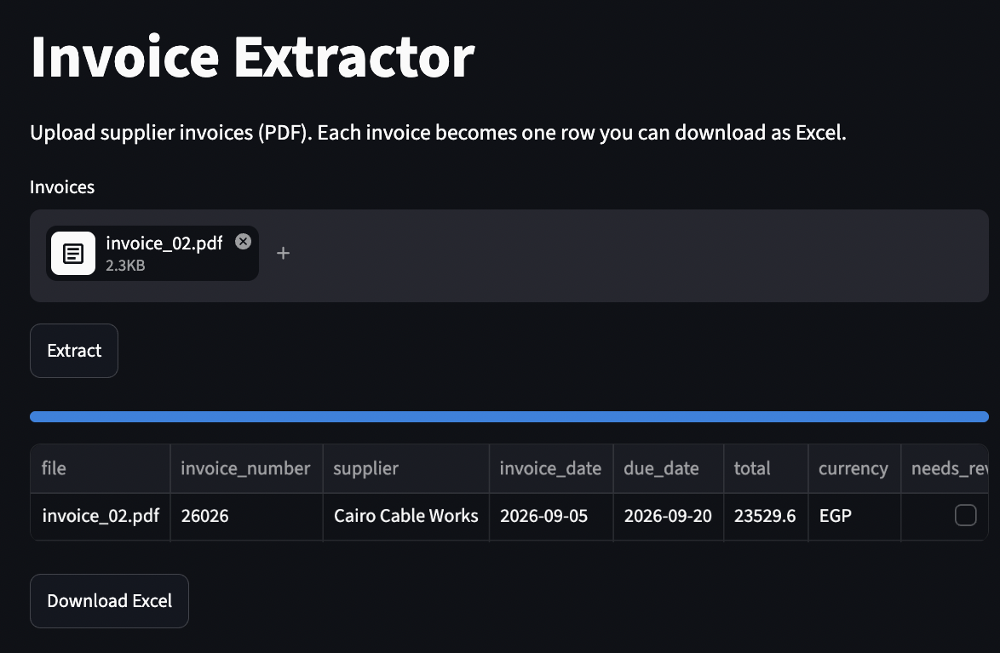
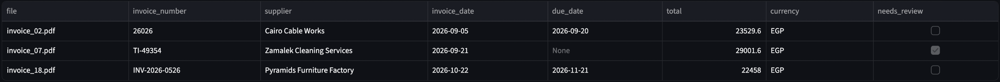
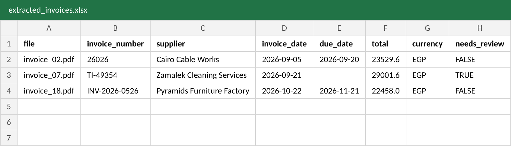
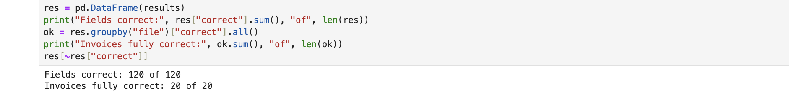

# Invoice Extractor

Turns supplier invoice PDFs into clean Excel rows using Gemini, replacing manual data entry in finance teams.



## The business problem
Finance and procurement teams type invoice details from PDFs into their systems by hand. It is slow, boring and error-prone. This app reads each invoice and fills in the fields automatically, and it flags the ones a person should check before payment.

**Input:** a supplier invoice PDF
**Output:** Invoice number · Supplier · Invoice date · Due date · Total · Currency, as an Excel row

## How it works
1. **Read the PDF** with `pypdf`.
2. **Scanned invoices** have no text layer, so the PDF itself is sent to Gemini to read as an image (fallback).
3. **Gemini extracts the fields** into a fixed shape defined with **Pydantic** (structured output): dates as `YYYY-MM-DD`, totals as numbers.
4. **Rules in the prompt:** only use values printed on the invoice; if a field is missing, leave it empty and never guess.
5. **Supplier names are matched** to a supplier master list, so `HORUS IT SERVICES` and `Horus IT Services` count as the same supplier.
6. **Rows with empty fields are flagged** (`needs_review`) for a person to check (human in the loop).
7. **Reliability:** 60-second timeout on each call, retries, and a backup model when the main one is overloaded.

## Example
Three invoices processed together: a normal one, one with no due date printed (flagged for review), and a scanned one read as an image.



The download button gives the same rows as an Excel file:



## Results
Tested on 20 invoices (4 different layouts) against a hand-made answer key, 6 fields each = 120 checks (see `read_invoices.ipynb`).



| Version | Fields correct | Invoices fully correct |
|---|---|---|
| First run | 115 / 120 (96%) | 15 / 20 |
| After supplier matching | **120 / 120 (100%)** | **20 / 20** |

The test set includes deliberate traps, all handled correctly:
- A PO number printed next to the invoice number
- No due date printed, only "Net 30 days from delivery" (correct answer: empty)
- No invoice number printed (correct answer: empty)
- USD instead of EGP
- A 10% discount line
- A date written as "3rd Oct 2026"
- A scanned invoice with no text layer

## Problems I hit and how I fixed them
| Problem | Fix |
|---|---|
| Scanned invoice returned empty text with no error | Detect empty text and send the PDF to Gemini as an image |
| Gemini calculated a due date from "Net 30" (a convincing hallucination) | Added explicit "never calculate or guess" rules |
| Supplier names in ALL CAPS on one layout | Matched names to a supplier master list in code |
| 503 "model overloaded" errors | Retries with a backup model |
| App hung forever with no error | Added a 60-second timeout to every API call |
| API key ended up in a file name | Replaced the key, stored it in `.env`, excluded from Git |

## Limitations
The 100% score is on a small, synthetic, English-only test set with mostly clean digital PDFs. Real invoices (Arabic text, phone photos, handwriting, multiple pages, stamps) would need a larger test set before trusting it in production.

## Run it yourself
```
python3 -m venv .venv
source .venv/bin/activate
pip install -r requirements.txt
echo "GEMINI_API_KEY=your_key_here" > .env
streamlit run app.py
```
Get a free API key at [Google AI Studio](https://aistudio.google.com/apikey).

## Tech
Python · Gemini API (`gemini-3.1-flash-lite`, backup `gemini-3.5-flash`) · Pydantic · pypdf · pandas · Streamlit
